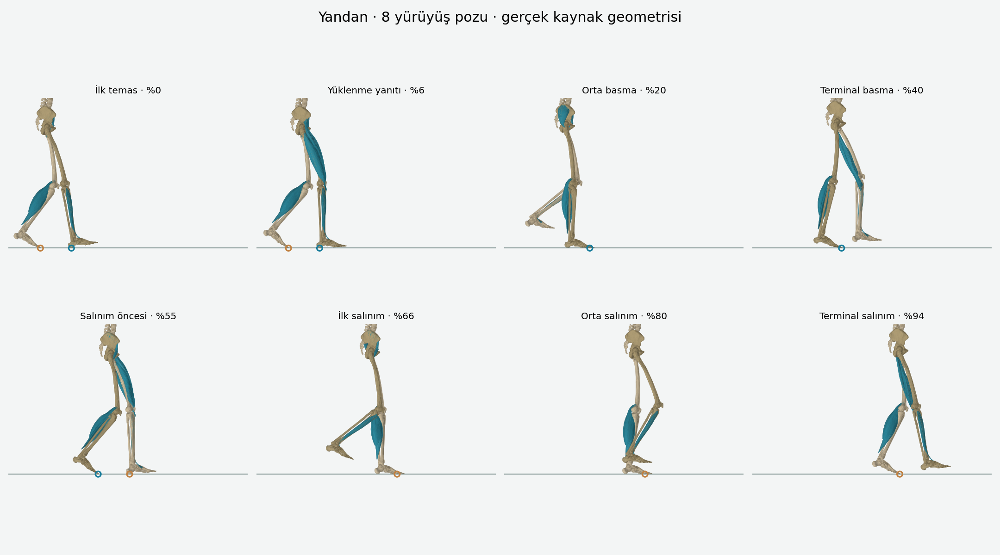
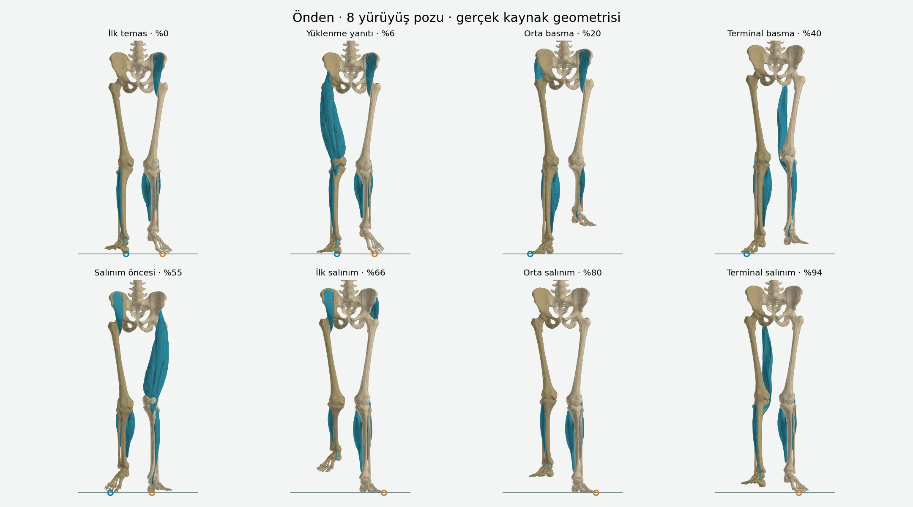

# Gait update from saved version 28

Base source: 4ba99fdba6dce42d928dc81831601450c403accf (saved version 28).

The gait lesson now poses the existing atlas skeleton through eight reference poses (0, 6, 20, 40, 55, 66, 80, 94 percent). Playback traverses the full 0–100 percent cycle and stops at the next initial contact. Phase selection interpolates through the cycle over 650 ms. The other leg is offset by 50 percent. Playback, pause, scrub, previous/next phase and half/double speed are available.

Bilateral hip/knee/ankle transforms use foot targets and a two-link inverse kinematic chain, preserving bone lengths and joint connections. Stance rotates around fixed plantar heel/forefoot pivots. Ground height is derived from the actual foot vertices, including swing clearance. Pelvis height follows the supporting limb; first contact and loading response use 5 and 15 degrees of knee flexion. Contact rings and text distinguish heel, sole, forefoot, swing, single support and double support.

Muscles and the sagittal plane default to off inside a closed disclosure. Muscles deform with the relevant leg and are selected by that leg's own phase. The displayed muscle contribution is an approximate teaching summary, not measured activation. Other movement families retain their existing rig logic.

Validation:
- TypeScript check and production client/worker build.
- 401 cycle samples: no foot penetration; planted stance soles; positive swing clearance; rigid bone lengths; connected knees and ankles; continuous phase boundaries and next initial contact.
- Fixed heel and forefoot horizontal pivots during stance.
- All eight poses with muscles and plane both disabled and enabled; finite muscle vertices.
- Existing lower-limb, knee, movement defaults and server-rendered movement UI checks.
- Side and front CPU projections of the actual source meshes, shown below. These are geometry reviews, not browser WebGL screenshots.
- The cloud test browser reports WebGL context creation unavailable. Live GPU appearance cannot be verified in that browser.

Teaching reference: https://now.aapmr.org/biomechanics-normal-gait/
