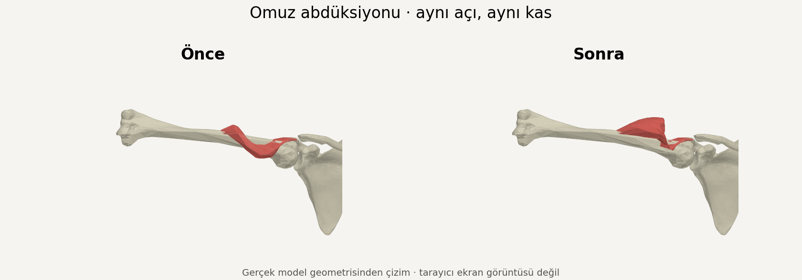

# Shoulder deformation repair — V26

The reported isolated acromial deltoid fold at 90° abduction was reproduced using the V25 production geometry. The earlier combined-muscle galleries hid this defect.

## Changes

- Give each deltoid head its own origin seeds. Deltoid and coracobrachialis bellies follow the humerus, with blending restricted to the proximal region.
- Keep rotator-cuff bellies on the scapula and deform their lateral insertion region. This prevents the observed subscapularis/infraspinatus disappearance through the scapula.
- Use monotonic medial-to-lateral pectoralis weights. Move pectoralis, latissimus and teres major using attachment displacement, transitioning to exact humeral rotation distally, avoiding the observed remote-axis folds.
- Preserve source geometry, tendon-region following, footprint attachment, picking and opt-in display defaults.

## Verification

- Exported 138 isolated primary-muscle poses across six shoulder movements, both sides and start/middle/end. Inspected selected front, back and side views; refreshed the 72 abduction/rotation exports after the cuff correction.
- Inspected the final 36-pose bilateral shoulder gallery with antagonists, cuff and tendons enabled.
- New belly regression: 120 movement/side/scapula/progress combinations, 26,840 humeral belly vertex checks and 224,940 fixed scapular belly vertex checks. Passes the repaired implementation. Running it against V25 fails with `shoulder belly folds away from humerus`.
- Existing shoulder muscle, shoulder study and muscle stability regressions pass, including neutral pose, source preservation, tendon following and footprint attachment. Type check passes.

These are CPU projections of production mesh geometry, not browser screenshots. The available test browser cannot initialize WebGL, so GPU rendering has not been verified here. The deformation remains an educational approximation, not a complete biomechanical or soft-tissue collision simulation.
